  

  <samp>
    「 好奇心の、その先へ。 」 
    <a href="https://github.com/wangshen233?tab=repositories">repositories</a> ·
    <a href="https://github.com/wangshen233/turb-register-public">turb-studio</a> ·
    <a href="https://github.com/wangshen233/codex-oauth-helper">oauth-helper</a> ·
    <a href="https://wangshen233.github.io">personal-site</a> ·
    <a href="https://github.com/wangshen233/wangshen233/issues/new?title=%F0%9F%95%8A%EF%B8%8F+%E6%94%BE%E9%A3%9E%E7%BA%B8%E9%B9%A4&amp;body=%E5%86%99%E4%B8%8B%E4%B8%80%E5%8F%A5%E6%83%B3%E7%95%99%E5%9C%A8%E6%B5%B7%E9%9D%A2%E4%B8%8A%E7%9A%84%E8%AF%9D%EF%BC%8826%E5%AD%97%E4%BB%A5%E5%86%85%EF%BC%8C%E6%8F%90%E4%BA%A4%E5%90%8E%E7%BA%A610%E7%A7%92%E8%87%AA%E5%8A%A8%E6%B5%AE%E7%8E%B0%E5%9C%A8%E4%B8%BB%E9%A1%B5%E6%B5%B7%E9%9D%A2%E4%B8%8A%EF%BC%89%EF%BC%9A%0A%0A%E4%B9%98%E7%9D%80%E6%B5%B7%E9%A3%8E%E8%B7%AF%E8%BF%87%E6%AD%A4%E5%9C%B0%EF%BC%8C%E7%A5%9D%E4%BB%8A%E5%A4%A9%E4%B9%9F%E6%B2%A1%E6%9C%89+bug%EF%BC%81">send-a-paper-crane 🕊️</a>
  </samp>

 

<picture><source media="(prefers-color-scheme: dark)" srcset="./assets/fm233-dark.svg" /><source media="(prefers-color-scheme: light)" srcset="./assets/fm233-light.svg" /></picture>

### 👋 嗨，我是 日天

- 🔭 热衷于把复杂的 **协议逆向** 与 **自动化链路** 打磨成干净顺手的小工具
- 🦀 日常主力 `Python` · `Rust` · `Go`，信奉「能走纯协议就绝不开浏览器」
- 🌙 常年活跃在深夜车厢，写完最后一个 bug 就去吹海风
- 📻 右边这台收音机每天自动同步最新仓库星标，常驻循环久石让

  <picture><source media="(prefers-color-scheme: dark)" srcset="./assets/tech-stack-dark.svg" /><source media="(prefers-color-scheme: light)" srcset="./assets/tech-stack-light.svg" /></picture>

 

  <a href="https://wangshen233.github.io" title="点击进入 Station 233 交互式 WebGL 引力透镜黑洞星环、五维视界终端与引力弹弓纸船实验室">
    <picture>
      <source media="(prefers-color-scheme: dark)" srcset="./assets/galaxy-blackhole-dark.svg" />
      <source media="(prefers-color-scheme: light)" srcset="./assets/galaxy-blackhole-light.svg" />
      
    </picture>
  </a>

  
    🕳️ <b>上方黑洞星环支持全交互</b> — 点任意位置直达 <a href="https://wangshen233.github.io"><b>wangshen233.github.io ↗</b></a> 滚轮操控 360° 银河星环、点击视界中心运行 <code>Sentinel</code> 五维终端，或亲手拖拽发射相对论引力弹弓折纸船
  

---

  <a href="https://github.com/wangshen233/turb-gpt-free-register-oss-20260928" title="Turb Register"><picture><source media="(prefers-color-scheme: dark)" srcset="./assets/cinema-turb-dark.svg" /><source media="(prefers-color-scheme: light)" srcset="./assets/cinema-turb-light.svg" /></picture></a>

  <a href="https://github.com/wangshen233/sentinel-rs" title="Sentinel-rs"><picture><source media="(prefers-color-scheme: dark)" srcset="./assets/cinema-sentinel-dark.svg" /><source media="(prefers-color-scheme: light)" srcset="./assets/cinema-sentinel-light.svg" /></picture></a>

  <a href="https://github.com/wangshen233/upi-zero-link" title="UPI Zero Link"><picture><source media="(prefers-color-scheme: dark)" srcset="./assets/cinema-upi-dark.svg" /><source media="(prefers-color-scheme: light)" srcset="./assets/cinema-upi-light.svg" /></picture></a>

  <a href="https://github.com/wangshen233/appleservices-family-private" title="AppleServices Family"><picture><source media="(prefers-color-scheme: dark)" srcset="./assets/cinema-apple-dark.svg" /><source media="(prefers-color-scheme: light)" srcset="./assets/cinema-apple-light.svg" /></picture></a>

---

  <picture><source media="(prefers-color-scheme: dark)" srcset="./assets/contributions-dark.svg" /><source media="(prefers-color-scheme: light)" srcset="./assets/contributions-light.svg" /></picture>

  <picture><source media="(prefers-color-scheme: dark)" srcset="./assets/paper-cranes-dark.svg" /><source media="(prefers-color-scheme: light)" srcset="./assets/paper-cranes-light.svg" /></picture>

  
    🕊️ <b>这片海面是活的</b> — <a href="https://github.com/wangshen233/wangshen233/issues/new?title=%F0%9F%95%8A%EF%B8%8F+%E6%94%BE%E9%A3%9E%E7%BA%B8%E9%B9%A4&amp;body=%E5%86%99%E4%B8%8B%E4%B8%80%E5%8F%A5%E6%83%B3%E7%95%99%E5%9C%A8%E6%B5%B7%E9%9D%A2%E4%B8%8A%E7%9A%84%E8%AF%9D%EF%BC%8826%E5%AD%97%E4%BB%A5%E5%86%85%EF%BC%8C%E6%8F%90%E4%BA%A4%E5%90%8E%E7%BA%A610%E7%A7%92%E8%87%AA%E5%8A%A8%E6%B5%AE%E7%8E%B0%E5%9C%A8%E4%B8%BB%E9%A1%B5%E6%B5%B7%E9%9D%A2%E4%B8%8A%EF%BC%89%EF%BC%9A%0A%0A%E4%B9%98%E7%9D%80%E6%B5%B7%E9%A3%8E%E8%B7%AF%E8%BF%87%E6%AD%A4%E5%9C%B0%EF%BC%8C%E7%A5%9D%E4%BB%8A%E5%A4%A9%E4%B9%9F%E6%B2%A1%E6%9C%89+bug%EF%BC%81"><b>点这里写一句话放飞纸船 ↗</b></a>，GitHub Actions 会在 10 秒内把你的 ID 与留言画进上方海面里漂流
  

 

  
📈 <b>沿途星光轨迹 · Star History</b>

   
  

    <a href="https://www.star-history.com/#wangshen233/turb-gpt-free-register-oss-20260928&amp;wangshen233/sentinel-rs&amp;wangshen233/upi-zero-link&amp;wangshen233/appleservices-family-private&amp;wangshen233/turb-register-public&amp;Date" title="查看完整 Star History">
      <picture>
        <source media="(prefers-color-scheme: dark)" srcset="https://api.star-history.com/svg?repos=wangshen233/turb-gpt-free-register-oss-20260928%2Cwangshen233/sentinel-rs%2Cwangshen233/upi-zero-link%2Cwangshen233/appleservices-family-private%2Cwangshen233/turb-register-public&amp;type=Date&amp;theme=dark" />
        <source media="(prefers-color-scheme: light)" srcset="https://api.star-history.com/svg?repos=wangshen233/turb-gpt-free-register-oss-20260928%2Cwangshen233/sentinel-rs%2Cwangshen233/upi-zero-link%2Cwangshen233/appleservices-family-private%2Cwangshen233/turb-register-public&amp;type=Date" />
        
      </picture>
    </a>
  

  <samp>旅は、つづく。 · Station 233</samp>

