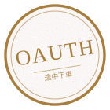
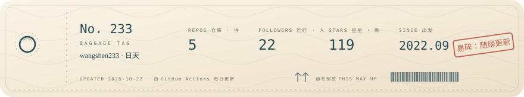

<p align="center">
  
</p>

<a name="projects"></a>

<p align="center">
  
</p>

<p align="center">
  <a href="https://github.com/wangshen233/upi-zero-link" title="UPI 委托链接提取 · Python / 纯协议">UPI Zero Link ↗</a>　 · 　<a href="https://github.com/wangshen233/turb-gpt-free-register-oss-20260928" title="脱敏开源的自动化注册工具 · Python">Turb Register ↗</a><br />
  <a href="https://github.com/wangshen233/codex-oauth-helper" title="OAuth 登录、令牌刷新与 CPA JSON 导出">Codex OAuth Helper ↗</a>　 · 　<a href="https://github.com/wangshen233/wangshen233.github.io" title="个人网页项目 · HTML">Personal Site ↗</a>
</p>

<details>
  <summary>这几站，都在折腾什么？</summary>

  <br />

  **[UPI Zero Link](https://github.com/wangshen233/upi-zero-link)** — 印度 ₹0 UPI 委托链接提取，纯协议实现，交付前核验结果。

  **[Turb Register](https://github.com/wangshen233/turb-gpt-free-register-oss-20260928)** — 自动化注册工具的脱敏开源版本，把重复操作整理成流程。

  **[Codex OAuth Helper](https://github.com/wangshen233/codex-oauth-helper)** — 独立 OAuth 登录、令牌刷新与 CPA JSON 导出工具。

  **[Personal Site](https://github.com/wangshen233/wangshen233.github.io)** — 一个从简单 HTML 开始的个人网页项目。

</details>

<p align="center">
  
</p>

<details>
  <summary>🐈 值班站长室（点开有猫）</summary>
  <br />
  <p align="center">
    
  </p>
</details>

<p align="center">
  <sub>盖章打卡 · 每一站都算数</sub>
</p>

<p align="center">
  <a href="https://github.com/wangshen233/upi-zero-link" title="UPI Zero Link"></a>
  <a href="https://github.com/wangshen233/turb-gpt-free-register-oss-20260928" title="Turb Register"></a>
  <a href="https://github.com/wangshen233/codex-oauth-helper" title="Codex OAuth Helper"></a>
  <a href="https://github.com/wangshen233/wangshen233.github.io" title="Personal Site"></a>
</p>

<p align="center">
  <picture>
    <source media="(prefers-color-scheme: dark)" srcset="https://raw.githubusercontent.com/wangshen233/wangshen233/main/assets/contributions-dark.svg" />
    <source media="(prefers-color-scheme: light)" srcset="https://raw.githubusercontent.com/wangshen233/wangshen233/main/assets/contributions-light.svg" />
    
  </picture>
</p>

<details>
  <summary>🧳 行李牌 &amp; 车票背面</summary>
  <br />
  <p align="center">
    
  </p>

  **乘客须知**

  - 车票长期有效，从 2022 年 9 月开始，没有终点站。
  - 随身行李不限重，但请勿携带没解决的 bug 上车。
  - 车厢内欢迎大声讨论灵感，禁止在凌晨三点之后发版。
  - 座位 233 常年空着，路过就坐下。
  - 深夜加班专列每晚 22:00 从 5 站台开行，天亮前收工。

  **今天想坐哪趟车？**

  - 想看手艺 → [四个项目都停在这里](https://github.com/wangshen233?tab=repositories)
  - 想随便逛逛 → [去个人小站坐一会儿](https://wangshen233.github.io)
  - 想留句话 → [在站台留言板写一行](https://github.com/wangshen233/upi-zero-link/issues)
  - 想抄作业 → [fork 一节车厢带走](https://github.com/wangshen233?tab=repositories)

  <sub>行李牌上的数字由 Actions 每天更新一次，晚点属于正常现象。</sub>
</details>

<details>
  <summary>✦ 沿途收到的星星 · Star History</summary>
  <br />
  <p align="center">
    <a href="https://www.star-history.com/#wangshen233/upi-zero-link&amp;wangshen233/turb-gpt-free-register-oss-20260928&amp;wangshen233/codex-oauth-helper&amp;wangshen233/wangshen233.github.io&amp;Date" title="打开完整 Star History">
      <picture>
        <source media="(prefers-color-scheme: dark)" srcset="https://api.star-history.com/svg?repos=wangshen233/upi-zero-link,wangshen233/turb-gpt-free-register-oss-20260928,wangshen233/codex-oauth-helper,wangshen233/wangshen233.github.io&amp;type=Date&amp;theme=dark" />
        <source media="(prefers-color-scheme: light)" srcset="https://api.star-history.com/svg?repos=wangshen233/upi-zero-link,wangshen233/turb-gpt-free-register-oss-20260928,wangshen233/codex-oauth-helper,wangshen233/wangshen233.github.io&amp;type=Date" />
        
      </picture>
    </a>
  </p>
</details>

<details>
  <summary>🕳️ 别点这里</summary>
  <br />

  你点了。本站就一个彩蛋，一趟没有名字的夜车：

  ```
        ______
       | 233 |
  _____|_____|___________________
 |                               |
 |   下一个坑      ○ ○ ○ ○ ○     |
 |_______________________________|
    ~    ~    ~    ~    ~    ~
  ```

  今日宜：写一行代码就睡觉。今日忌：在凌晨三点开新坑。

</details>

<p align="center"><sub><a href="https://github.com/wangshen233?tab=repositories">更多岔路 ↗</a>　 / 　<a href="https://github.com/wangshen233/upi-zero-link/issues">站台留言 ↗</a>　 / 　本站全天候供应咖啡</sub></p>
