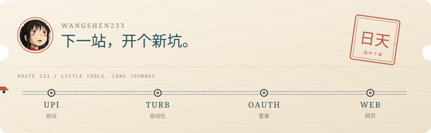

  

  

  <a href="https://github.com/wangshen233/upi-zero-link" title="UPI 委托链接提取 · Python / 纯协议">UPI Zero Link ↗</a>　 · 　<a href="https://github.com/wangshen233/turb-gpt-free-register-oss-20260928" title="脱敏开源的自动化注册工具 · Python">Turb Register ↗</a> 
  <a href="https://github.com/wangshen233/codex-oauth-helper" title="OAuth 登录、令牌刷新与 CPA JSON 导出">Codex OAuth Helper ↗</a>　 · 　<a href="https://github.com/wangshen233/wangshen233.github.io" title="个人网页项目 · HTML">Personal Site ↗</a>

  
这几站，都在折腾什么？

   

  **[UPI Zero Link](https://github.com/wangshen233/upi-zero-link)** — 印度 ₹0 UPI 委托链接提取，纯协议实现，交付前核验结果。

  **[Turb Register](https://github.com/wangshen233/turb-gpt-free-register-oss-20260928)** — 自动化注册工具的脱敏开源版本，把重复操作整理成流程。

  **[Codex OAuth Helper](https://github.com/wangshen233/codex-oauth-helper)** — 独立 OAuth 登录、令牌刷新与 CPA JSON 导出工具。

  **[Personal Site](https://github.com/wangshen233/wangshen233.github.io)** — 一个从简单 HTML 开始的个人网页项目。

  <picture>
    <source media="(prefers-color-scheme: dark)" srcset="https://raw.githubusercontent.com/wangshen233/wangshen233/main/assets/contributions-dark.svg" />
    <source media="(prefers-color-scheme: light)" srcset="https://raw.githubusercontent.com/wangshen233/wangshen233/main/assets/contributions-light.svg" />
    
  </picture>

  
✦ 沿途收到的星星 · Star History

   
  

    <a href="https://www.star-history.com/#wangshen233/upi-zero-link&amp;wangshen233/turb-gpt-free-register-oss-20260928&amp;wangshen233/codex-oauth-helper&amp;wangshen233/wangshen233.github.io&amp;Date" title="打开完整 Star History">
      <picture>
        <source media="(prefers-color-scheme: dark)" srcset="https://api.star-history.com/svg?repos=wangshen233/upi-zero-link,wangshen233/turb-gpt-free-register-oss-20260928,wangshen233/codex-oauth-helper,wangshen233/wangshen233.github.io&amp;type=Date&amp;theme=dark" />
        <source media="(prefers-color-scheme: light)" srcset="https://api.star-history.com/svg?repos=wangshen233/upi-zero-link,wangshen233/turb-gpt-free-register-oss-20260928,wangshen233/codex-oauth-helper,wangshen233/wangshen233.github.io&amp;type=Date" />
        
      </picture>
    </a>
  

<a href="https://github.com/wangshen233?tab=repositories">更多岔路 ↗</a>　 / 　<a href="https://github.com/wangshen233/upi-zero-link/issues">站台留言 ↗</a>

