<p align="center">
  
</p>

<p align="center">
  <a href="https://github.com/wangshen233?tab=repositories"></a>
  <a href="https://github.com/wangshen233?tab=followers"></a>
  <a href="https://github.com/wangshen233"></a>
</p>

<h1 align="center">日天 / wangshen233</h1>

<p align="center">
  <b>把好奇心写成代码，把重复的事交给自动化。</b><br />
  <sub>Read the protocol. Build the tool. Make it work.</sub>
</p>

<br />

### / about

喜欢追着一个问题往下挖，也喜欢把研究变成真正能用的小工具。
这里放着我的协议研究、Python 自动化，以及一些从「能不能做」开始的实验。

```python
class WangShen:
    name = "日天"
    handle = "@wangshen233"
    focus = ["Python", "Protocols", "Automation"]

    def build(self, idea):
        while not idea.works:
            idea.learn().debug().iterate()
        return idea.share()
```

### / selected work

| PROJECT | WHAT IT DOES |
| :--- | :--- |
| **[upi-zero-link](https://github.com/wangshen233/upi-zero-link)**<br /><sub>PYTHON · PROTOCOL</sub> | 印度 ₹0 UPI 委托链接提取工具，使用纯协议实现。<br /><sub>Explore the request flow, then turn it into a tool.</sub> |
| **[turb-gpt-free-register](https://github.com/wangshen233/turb-gpt-free-register-oss-20260928)**<br /><sub>PYTHON · AUTOMATION</sub> | turb-gpt-free-register 的脱敏开源版本。<br /><sub>A sanitized release of an automation project.</sub> |
| **[codex-oauth-helper](https://github.com/wangshen233/codex-oauth-helper)**<br /><sub>PYTHON · OAUTH · CLI / GUI</sub> | 独立的 OAuth 登录与凭据管理工具，提供命令行和桌面界面。<br /><sub>A focused helper for the standard OAuth flow.</sub> |

<p>
  <a href="https://github.com/wangshen233/upi-zero-link/stargazers"></a>
  <a href="https://github.com/wangshen233/turb-gpt-free-register-oss-20260928/stargazers"></a>
</p>

### / toolbox

<p>
  
  
  
  
  
</p>

### / say hello

有问题、有想法，或者发现了一个值得折腾的东西，欢迎到对应项目的 Issues 聊聊。

[查看所有公开项目 →](https://github.com/wangshen233?tab=repositories)

---

<p align="center">
  <sub><code>curiosity → experiments → useful things</code></sub><br />
  <sub>Always a work in progress.</sub>
</p>
